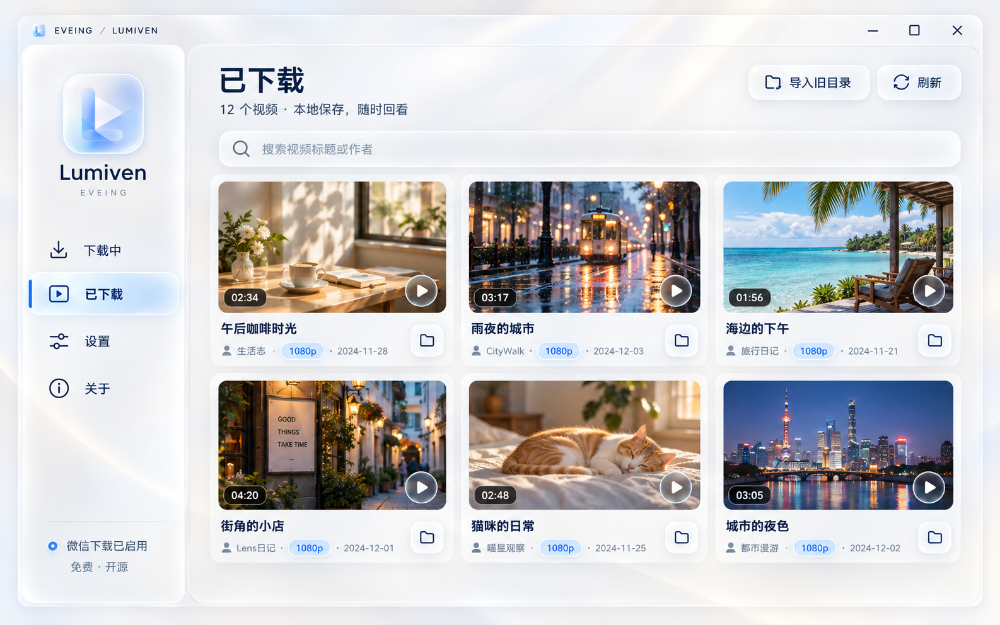
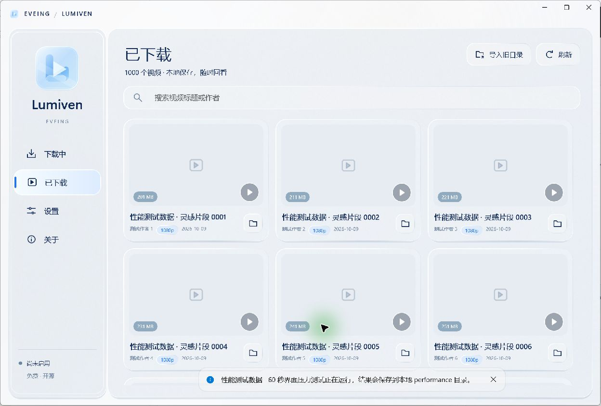

# EVEING Lumiven

免费的 Windows 微信视频号下载与本地媒体管理软件。界面采用清透玻璃、圆角与轻层次设计；使用 [nobiyou/wx_channel](https://github.com/nobiyou/wx_channel) 的下载与解密内核，新增 WinUI 桌面界面、统一任务记录和下载文件管理。

**状态：首版开发与验收中。** 不将设计图、编译成功或本地夹具测试视为真实微信下载验收。实际完成情况与限制记录于 `docs/VALIDATION.md`，发布前必须完成安装、微信获取、下载、播放和退出恢复检查。



上图是用户批准的设计参考，**不是软件运行截图**。实际界面及运行验证另行记录。



上图为真实程序窗口，卡片内容是性能测试生成的占位记录，不代表真实微信下载结果。

## 使用方式

首版仅支持 Windows 11 x64（系统版本 22000 或更新）；Windows 10 将在后续验证。安装包包含 .NET 和 Windows App SDK 运行时，无需自行安装 Go 或 .NET。

1. 安装 `EVEING-Lumiven-Setup-1.0.0-x64.exe`，启动普通权限桌面程序。
2. 在首次启用微信下载时，阅读证书、HTTPS 处理及当前用户代理的说明；主动点击启用后，后台内核以当前用户权限运行。
3. 打开电脑微信的视频号页面，使用注入的下载入口。软件显示任务与保存结果。
4. 在“已下载”中预览、播放视频或定位文件；在设置中选择保存文件夹。
5. 停止微信下载或退出软件时恢复之前的代理状态，并移除本次接入安装的证书。

安装器仅安装应用文件及用户选择的快捷方式，不安装驱动、不静默修改代理、不自动设置开机启动。卸载保留下载视频与应用数据；卸载前先停止微信下载。若微信不使用 WinInet 代理，或新版页面改变了原始流/注入接口，软件应显示具体连接失败，不能保证所有微信版本均兼容。

## 源码构建

仓库使用固定工具链：.NET SDK 10.0.401、Go 1.27.1、Zig 0.13.0、Node 24.19.0（仅测试）、Inno Setup 6.5.4。下载 URL 与校验值位于 `scripts/toolchain.json`，不会下载 latest。Go CGO 通过固定 Zig C 编译器构建；安装工具链不等于安装应用。

```powershell
pwsh ./scripts/Prepare-Tools.ps1 -IncludeInstaller
pwsh ./scripts/Verify-Licenses.ps1
pwsh ./scripts/Build.ps1 -Installer
# 在准确的待发布源码已提交、工作区干净后，重新构建并生成源码包及包含两者的 SHA256SUMS：
pwsh ./scripts/Build.ps1 -Installer -SourceArchive
```

输出位于 `artifacts/release`：安装包、对应源码 ZIP、`SHA256SUMS`。构建细节与发布验收见 `docs/BUILD.md`。GitHub Actions 默认对 main 构建与测试；tag `v1.0.0` 的公开 Release 需要 GitHub `release` 环境审批与完整验收记录。

## 开源与关于

EVEING 新增代码使用 GPL-3.0-only；继承的 wx_channel 文件保留 MIT 版权。Gopeed 为 GPL-3.0，SunnyNet 与其他组件保留各自许可证。完整文本见 `LICENSE`、`NOTICE`、`THIRD-PARTY-NOTICES.md` 和 `docs/licenses`。NetFilter SDK 商业驱动/API 不包含在本项目中，审计依据见 `docs/PROVENANCE.md`。

本软件由 EVEING 基于 GitHub 开源项目 wx_channel 开发，免费分享，不收费。感谢上游作者与开源贡献者。本项目与腾讯、微信及上游作者没有官方隶属关系。请在有权保存内容的场景中使用。

联系：0399199@gmail.com
